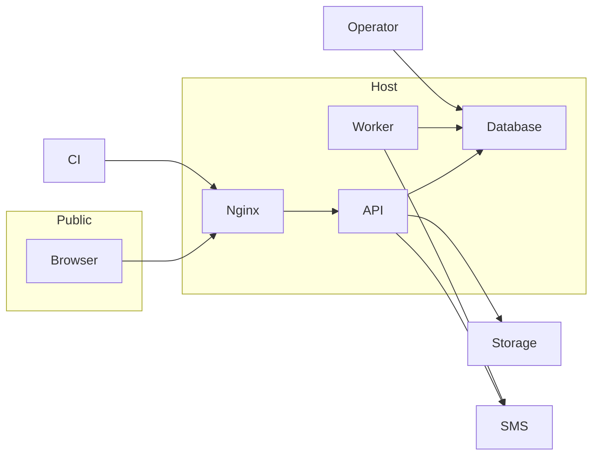

## Executive summary

ورسا فروشگاه تک‌فروشندهٔ زعفران با React/TypeScript و API مبتنی بر Express و PostgreSQL است. مهم‌ترین خطر اولیه، تصاحب پنل مدیر با رمز مشترک و توکن غیرقابل ابطال بود. مرزهای حساس بعدی، ورود پیامکی، مالکیت سفارش و پیوست، بودجهٔ پیامک و پردازش تصویر هستند. پرداخت آنلاین فعال نیست. اصلاحات و شواهد اعتبارسنجی در `findings.md` و `verification.md` ثبت می‌شوند؛ این مدل به‌تنهایی تأیید آمادگی انتشار نیست.

## Scope and assumptions

- کد فعال: `artifacts/api-server/src`، `artifacts/varsa-shop/src`، `lib/db/migrations` و `ops`؛ نسخهٔ مبنا در `.local/security-baseline-20261027` حفظ شده است. پوشه Git ندارد و تفکیک تغییرات پیشین با commit ممکن نبود.
- فرض‌های تأییدشده توسط مالک: یک فروشنده، اینترنت عمومی، میزبانی نهایی ایران، دادهٔ واقعی مشتری، ورود پیامکی و فایل خصوصی، بدون پرداخت آنلاین.
- پاسخ مالک دربارهٔ دامنه، میزبان و مسیر پراکسی: «فعلا مشخص نیست». TLS واقعی، فایروال، ظرفیت، محل backup و سیاست bucket هنوز نیازمند تنظیم میزبان هستند.
- دیتابیس عملیاتی، خدمات ثالث، خرید سرویس و انتشار خارج از اجرا هستند. تمام تست‌های فعال باید فقط روی loopback و دادهٔ ساختگی اجرا شوند.
- ابزار توسعه/اسکن در همان شبکهٔ عمومی سایت منتشر نمی‌شود. اگر این فرض نقض شود، ریسک S3rver و ابزار codegen باید دوباره ارزیابی شود.

## System model

### Primary components

React storefront و پنل مدیر از API هم‌مبدأ استفاده می‌کنند. Express سفارش را با قیمت فعلی سرور ثبت می‌کند؛ PostgreSQL مسئول موجودی، نشست‌ها، OTP و outbox است. Worker مستقل انقضای رزرو و ارسال اعلان را اجرا می‌کند. S3 خصوصی نگهدارندهٔ bytes است. Nginx پیشنهادی فایل HTML/CSS/JS را ارائه می‌کند؛ بنابراین CSP صفحه در همان لایه لازم است.

### Data flows and trust boundaries

- اینترنت → Nginx → Express: JSON، کوکی، OTP و تصویر؛ TLS روی میزبان، محدودیت بدنه/زمان، CSRF امضاشده، Origin allowlist و trust proxy با IP صریح. شواهد: `src/app.ts`، `src/lib/http-security.ts`، `ops/nginx-varsa.conf`.
- Express → PostgreSQL: query پارامتری و تراکنش؛ نقش runtime جدا از migration، نشست تصادفی فقط با hash در ذخیره‌سازی، مالکیت از نشست. شواهد: `src/lib/admin-security.ts`، `modules/customers/router.ts`، `modules/orders/service.ts`.
- Express → S3: نام تصادفی و checksum، سهمیهٔ اتمیک؛ تصویر جدید دوباره encode می‌شود. مسیر خصوصی از API با کنترل مالکیت و `private, no-store` ارائه می‌شود. شواهد: `modules/files/storage.ts`.
- Worker/API → سرویس پیامک: تلفن و متن ضروری، HTTPS، timeout، سقف پایدار مشترک و audit مصرف؛ دادهٔ provider وارد log نمی‌شود. شواهد: `modules/customers/auth.ts`، `modules/notifications/queue.ts`، `lib/sms-budget.ts`.
- اپراتور → migration و مدیریت حساب: دسترسی سیستم‌عامل و اتصال owner صریح؛ بدون endpoint عمومی ساخت مدیر. شواهد: `scripts/admin-account.ts`، `scripts/migrate-commerce.ts`.
- CI → artifact: lockfile، audit، Gitleaks، تست و build؛ هیچ رمز عملیاتی برای build لازم نیست.

#### Diagram

## Assets and security objectives

| Asset | Why it matters | Security objective (C/I/A) |
|---|---|---|
| شماره و نشانی، سفارش و تیکت | حریم خصوصی و اعتماد مشتری | C/I |
| پیوست خصوصی | جلوگیری از افشای محتوا و دسترسی بین مشتریان | C/I |
| حساب مدیر، MFA و نشست | کنترل همهٔ داده‌ها و قیمت‌ها | C/I |
| قیمت، کوپن و موجودی | جلوگیری از سفارش نادرست و فروش بیش از موجودی | I/A |
| اعتبار و بودجهٔ پیامک | هزینه و دسترس‌پذیری ورود | I/A |
| اسرار DB، S3 و encryption key | محافظت از همهٔ داده‌ها و امکان بازیابی | C/A |
| audit و backup | کشف رخداد و بازیابی قابل اعتماد | I/A |

## Attacker model

### Capabilities

مهاجم می‌تواند درخواست HTTP، شناسه، بدنه، MIME، Origin و forwarded headers بسازد، با چند IP تلاش کند، حساب مشتری خودش را با شمارهٔ تحت کنترل ایجاد کند و درخواست هم‌زمان بفرستد. XSS یا سرقت رمز مدیر به‌عنوان مرحلهٔ بعدی یک زنجیره بررسی می‌شود.

### Non-capabilities

دسترسی shell، مالکیت دیتابیس، خواندن env میزبان، شکست TLS، کنترل شمارهٔ قربانی یا نفوذ به provider بدون شاهد فرض نشده است. نقش فروشندهٔ دیگر، API پرداخت و وب‌هوک پرداخت در محصول فعال وجود ندارد.

## Entry points and attack surfaces

| Surface | How reached | Trust boundary | Notes | Evidence (repo path / symbol) |
|---|---|---|---|---|
| ورود مدیر و MFA | `/api/admin/*` | اینترنت/حساب دارای امتیاز | enrollment مجوز پنل ندارد | `lib/admin-security.ts` |
| OTP و شماره | `/api/customer/auth/*` | شماره/هویت مشتری | یک‌بارمصرف، کوتاه‌عمر و محدود | `modules/customers/auth.ts` |
| سفارش و کوپن | `/api/orders`, `/api/store/quote` | قیمت مشتری/سرور | قیمت، idempotency و رزرو سمت سرور | `modules/orders` |
| آدرس و پشتیبانی | `/api/customer/*` | مشتری/مشتری دیگر | مالکیت در query و تراکنش | `modules/customers/router.ts` |
| تصویر و download | `/api/customer/media`, `/api/admin/media` | bytes/decoder/storage | فرمت واقعی، سقف پیکسل و مالکیت | `modules/files/storage.ts` |
| تماس | `/api/contact` | ناشناس/ذخیره و هزینه | محدودسازی شماره، شبکه و کل | `modules/content/router.ts` |
| worker | outbox در دیتابیس | کار HTTP/اثر بیرونی | lease و retry محدود | `modules/notifications/queue.ts` |
| HTML و metadata | Nginx، React | داده/مرورگر | escaping و CSP | `src/lib/page-meta.ts`, `ops` |
| CLI و CI | سیستم‌عامل/کد | اپراتور/مدیر سامانه | فقط ورودی صریح، بدون .env ضمنی | `scripts`, `.github/workflows` |

## Top abuse paths

1. حدس یا سرقت رمز مشترک → توکن قدیمی مرورگر → کنترل سفارش و دادهٔ خصوصی. حساب Argon2id، MFA اجباری و نشست قابل ابطال جایگزین شده‌اند.
2. ارسال فرم از سایت مهاجم → کوکی مشتری → تغییر تیکت/نشانی. توکن CSRF مستقل از وجود Origin و کنترل مبدأ مانع می‌شود.
3. ورود به حساب خود → تعویض شناسهٔ سفارش/تیکت/پیوست → اطلاعات مشتری دیگر. مالکیت از هویت سرور و query محدود به مالک بررسی می‌شود.
4. درخواست هم‌زمان با OTP، TOTP یا recovery یکسان → چند نشست یا استفادهٔ مجدد. مصرف در قفل ردیف و تراکنش سریالی می‌شود.
5. تصویر با MIME جعلی یا ابعاد بزرگ → پردازش بی‌حد → اختلال API. magic، decode سخت‌گیر، ابعاد/پیکسل/زمان و ظرفیت هم‌زمان محدود می‌شود.
6. چرخش IP و header جعلی → ارسال پیامک انبوه/سفارش مهمان → هزینه و اختلال. بودجهٔ هویت، شبکه و کل در دیتابیس و سقف ارسال مشترک اعمال می‌شود.
7. تغییر قیمت در بدنه یا تکرار checkout → تخفیف/موجودی اشتباه. قیمت و رزرو اتمیک سرور و تست PostgreSQL حفظ می‌شود.
8. نقش owner در runtime یا bucket عمومی → افشای وسیع در رخداد بعدی. نقش محدود در startup بررسی می‌شود؛ bucket و فایروال واقعی باید توسط میزبان تأیید شوند.

## Threat model table

| Threat ID | Threat source | Prerequisites | Threat action | Impact | Impacted assets | Existing controls (evidence) | Gaps | Recommended mitigations | Detection ideas | Likelihood | Impact severity | Priority |
|---|---|---|---|---|---|---|---|---|---|---|---|---|
| TM-001 | مهاجم اینترنتی | رمز ضعیف یا سرقت‌شده | تصاحب مدیر | دسترسی همهٔ سفارش‌ها | PII، موجودی | limiter قبلی؛ اکنون `admin-security.ts` | پیشتر MFA و revoke نبود | حساب مشخص، Argon2id، TOTP، کوکی و ابطال | audit ورود و تغییر رمز | high | high | high |
| TM-002 | سایت مهاجم | مرورگر واردشده | CSRF با Origin غایب | تغییر اطلاعات | حساب، تیکت | SameSite؛ اکنون `http-security.ts` | Origin قبلاً اختیاری بود | double-submit امضاشده و allowlist ثابت | نرخ 403 | high | medium | high |
| TM-003 | مشتری دیگر | حساب معتبر | IDOR در منابع خصوصی | افشای PII | سفارش/فایل | `owns`, `attachments`, `fileService.read` | زیرساخت cache نامعلوم | حفظ مالکیت و تست دو حساب، bucket خصوصی | 404های متوالی و log حداقلی | medium | high | high |
| TM-004 | مهاجم توزیع‌شده | HTTP عمومی | OTP و SMS abuse | هزینه/قطع ورود | بودجه و دسترسی | `customer_rate_limits` | اعلان‌ها قبلاً سقف مشترک نداشتند | سقف مشترک API/worker و هشدار | `sms_budget_exhausted` | high | medium | high |
| TM-005 | مشتری یا مدیر آلوده | اجازهٔ upload | تصویر بد یا بزرگ | مصرف حافظه/CPU | API و storage | محدودیت ۴MB و magic | decode/پیکسل/سهمیه قبلاً نبود | Sharp محدود و quota اتمیک | رد decoder و quota | medium | medium | medium |
| TM-006 | مشتری | checkout | رقابت سفارش/قیمت جعلی | فساد مالی/موجودی | قیمت و رزرو | `modules/orders/service.ts`، constraints | regressions هنگام auth | حفظ query و تست واقعی PG | اختلاف موجودی، idempotency conflict | medium | high | high |
| TM-007 | مهاجم زیرساخت | خطای میزبان | DB عمومی، cache فایل یا اسرار | افشای وسیع | همهٔ داده‌ها | `ops/database-runtime-grants.sql` | میزبان هنوز انتخاب نشده | راهنمای فعال‌سازی و آزمون واقعی | بررسی startup و readiness | unknown | high | high |
| TM-008 | ورودی شبکه | نسخهٔ آسیب‌پذیر parser/proxy | دورزدن IP یا crash | کاهش کنترل/دسترس‌پذیری | API | lockfile و audit | نسخه‌های قبلی آسیب‌پذیر | pin نسخهٔ اصلاح‌شده و تست کامل | CI audit + restart alerts | high | high | high |

## Criticality calibration

- critical: اجرای کد پیش از ورود، دسترسی عمومی DB به همهٔ PII، پذیرش توکن جعلی برای مدیر.
- high: تصاحب مدیر با یک عامل، افشای سفارش/فایل مشتری دیگر، اختلال کم‌هزینهٔ parser عمومی.
- medium: DoS تصویر در حساب محدود، مصرف بودجه با محدودیت ناکافی، پیکربندی مرورگر کم‌دفاع.
- low: fingerprint جزئی، ابزار توسعهٔ صرفاً loopback با ورودی trusted، توصیهٔ پیشگیرانهٔ بدون مسیر سوءاستفادهٔ اثبات‌شده.

## Focus paths for security review

| Path | Why it matters | Related Threat IDs |
|---|---|---|
| `artifacts/api-server/src/lib/admin-security.ts` | چرخهٔ کامل مدیر و MFA | TM-001, TM-004 |
| `artifacts/api-server/src/lib/http-security.ts` | CSRF و پیکربندی production | TM-002, TM-007 |
| `artifacts/api-server/src/modules/customers` | OTP، شماره و مالکیت | TM-003, TM-004 |
| `artifacts/api-server/src/modules/files` | decoder و quota و مجوز read | TM-003, TM-005 |
| `artifacts/api-server/src/modules/orders` | قیمت و رزرو | TM-006 |
| `artifacts/api-server/src/modules/notifications` | اثر بیرونی worker | TM-004 |
| `ops` | پاسخ‌دهندهٔ واقعی، DB و process | TM-007 |
| `pnpm-lock.yaml` | نسخهٔ واقعی dependencies | TM-008 |

## Notes on use

ورودی‌های اصلی، مرزهای داده، worker، مسیرهای مدیر و ابزارهای توسعه جدا بررسی شده‌اند. فرض‌های کسب‌وکار از درخواست مالک پذیرفته شده‌اند و نامعلوم بودن میزبان با پاسخ مستقیم مالک ثبت شده است. این سند باید پس از انتخاب میزبان، فعال‌سازی پرداخت یا تغییر ارائه‌دهندهٔ فایل/پیامک بازبینی شود.
